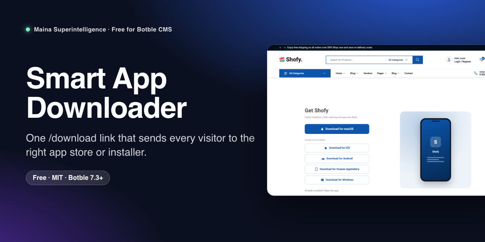
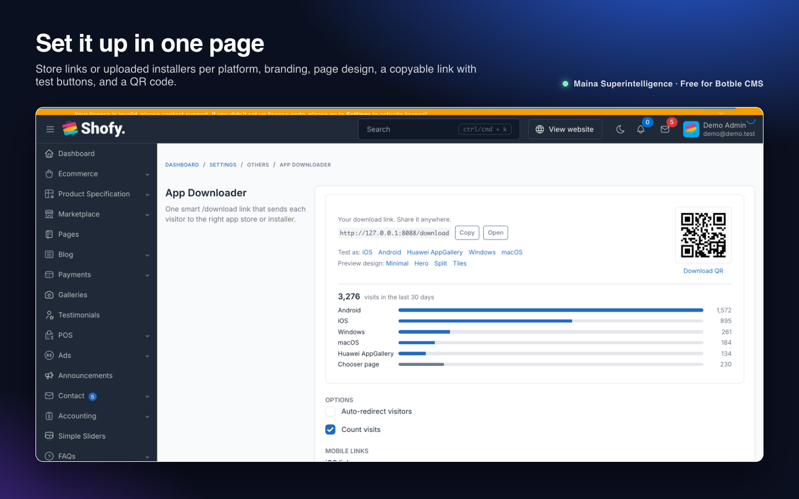
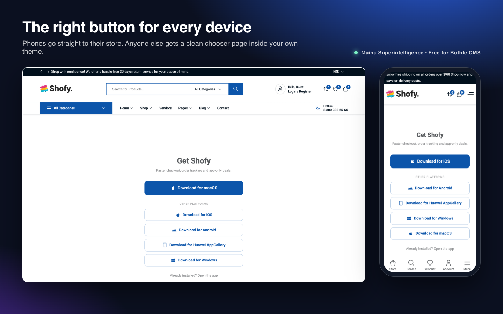
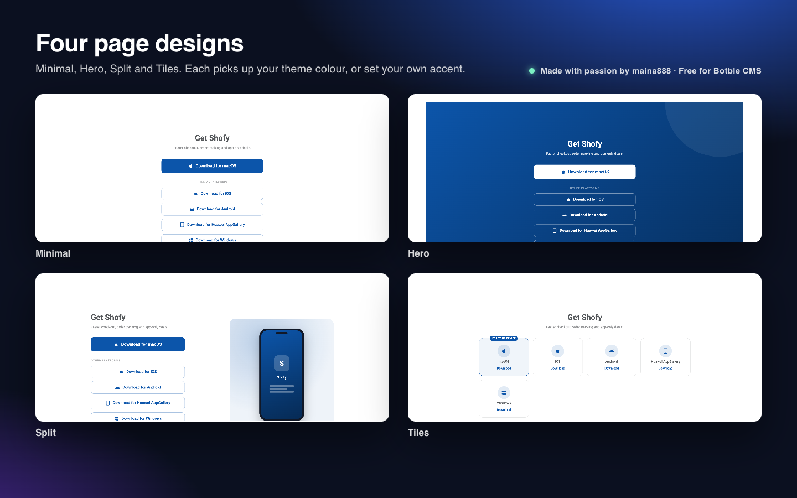
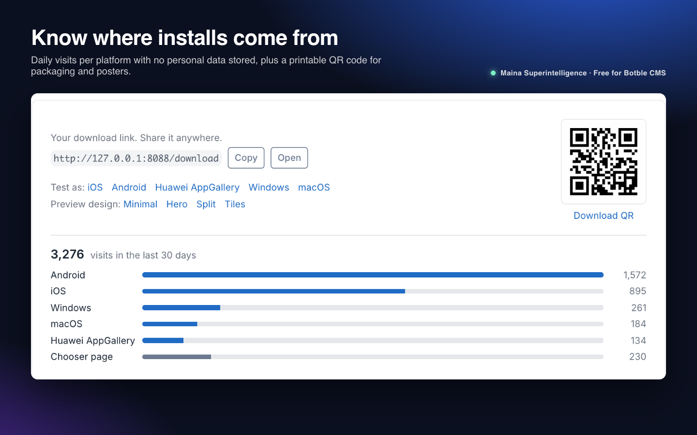

# Smart App Downloader for Botble CMS



One link for every device. Share `https://your-site.com/download` and each visitor lands in the right place: iPhone and iPad go to the App Store, Android to Google Play, Windows and Mac to your installer. Anyone we can't identify sees a clean chooser page inside your theme.

**Free and open source** by **Maina 888** · Maina Superintelligence Ltd

**Version:** 1.1.0 · **Requires:** Botble CMS core 7.3.0+, PHP 8.2+ · **License:** MIT

## Features

- **Smart redirect** from a single `/download` URL, based on the visitor's device.
- **8 platforms:** iOS, Android, Huawei AppGallery, Amazon Appstore, Windows, Microsoft Store, macOS and Linux. Huawei and Amazon devices fall back to your Android link, and Windows falls back to your Microsoft Store link, if you haven't set their own.
- **Minimal chooser page** for unknown devices or missing links: the visitor's platform as one big button, everything else underneath. It renders in your theme, picks up its primary colour, and needs no extra CSS or icon fonts.
- **Four page designs:** Minimal, Hero, Split and Tiles, plus an optional accent colour. Preview any design from the settings page before saving.
- **Upload installers:** upload an `.apk`, `.exe`/`.msi`, `.dmg`/`.pkg` or Linux package for Android, Huawei, Amazon, Windows, macOS and Linux right on the settings page. Large files are sent in chunks (up to 2 GB), stored privately and served as a download. An uploaded file is used instead of the platform's link.
- **Branding:** app name, one-line pitch, app icon, and an optional "Already installed? Open the app" deep link (`myapp://…` or an https universal link).
- **Visit counter:** daily hits per platform, shown on the settings page. No IP address, User-Agent or any personal data is stored, and you can switch it off.
- **QR code** for your `/download` link on the settings page, downloadable as SVG for print.
- **Settings page** under *Settings → Others → App Downloader* with a copy button and "Test as iOS / Android / …" links.
- **Translations:** English, Vietnamese, Spanish, French and Arabic.
- **Lightweight and safe:** one tiny table for the counter, no new Composer packages, http(s)-only links, and `Cache-Control: no-store` + `Vary: User-Agent` so CDNs never serve one visitor's redirect to another. Crawlers always get the chooser page, so it stays indexable.

## Screenshots

| Settings | Chooser page |
| --- | --- |
|  |  |
|  |  |

## Installation

### From the Botble Marketplace (recommended)

1. Go to **Admin → Plugins → Add new**.
2. Search for **Smart App Downloader**, click **Install**, then **Activate**.

Updates appear in **Admin → Plugins** whenever a new version is released.

### From a release zip

1. Download `app-downloader-x.y.z.zip` from the [latest release](https://github.com/Themaina/maina-app-downloader/releases/latest).
2. Go to **Admin → Plugins → Add new → Upload**, pick the zip, then **Activate**.

### Manually

1. Copy the `app-downloader` folder to `platform/plugins/app-downloader`.
2. Go to **Admin → Plugins** and click **Activate** (or run `php artisan cms:plugin:activate app-downloader`). Activation creates the counter table.
3. If the routes don't appear, run `php artisan optimize:clear`.

## Configuration

Open **Admin → Settings → Others → App Downloader**.

| Setting | What it does |
| --- | --- |
| Auto-redirect visitors | On: visitors go straight to the link for their device. Off: everyone sees the chooser page. |
| Count visits | Keeps a daily counter per platform for the stats on the settings page. |
| Page design / Accent color | Pick one of four designs; blank accent uses your theme colour. |
| Upload installers | Optional. A file uploaded for a platform replaces its link. |
| Mobile / Desktop links | One full `http://` or `https://` URL per platform. Leave blank to skip a platform. |
| App name | Page heading, e.g. "Get Acme". Blank uses "Get the App". |
| One-line pitch | Text under the heading. |
| App icon | Square image shown above the heading (144 × 144 px or larger). |
| "Open in app" link | Optional deep link, e.g. `myapp://open`. Adds an "Already installed?" link to the chooser page. |

## Usage

| URL | Behaviour |
| --- | --- |
| `/download` | Detects the device and redirects (HTTP 302). Falls back to the chooser page. |
| `/download?chooser=1` | Always shows the chooser page, no redirect. Good for "Other platforms" and "Open in app" links. |
| `/download?platform=ios` | Forces a platform (`ios`, `android`, `huawei`, `amazon`, `windows`, `microsoft`, `macos`, `linux`). Good for per-platform QR codes. |
| `/download?design=hero` | Previews a design (`minimal`, `hero`, `split`, `tiles`) without saving. |
| add `&preview=1` | Skips the visit counter. The test links on the settings page use it. |

Good places for the link: QR codes on print and packaging, email footers, social bios, smart banners, and a "Download the app" menu item (add `/download` as a custom link in **Appearance → Menus**).

### How detection works

| Platform | Matched when the User-Agent contains |
| --- | --- |
| iOS | `iPhone`, `iPad`, `iPod`, or `Macintosh` + `Mobile` (iPadOS in desktop mode) |
| Huawei | `Android`/`HarmonyOS` + `HUAWEI`, `HONOR`, `HMSCore` or `HuaweiBrowser` |
| Amazon | `Android` + `Silk`, a Fire tablet model (`KF…`, `AFT…`) or `Kindle Fire` |
| Android | any other `Android` |
| Windows | `Windows`, `Win32`, `Win64`, `WOW64` |
| macOS | `Macintosh` or `Mac OS X` |
| Linux | `Linux` or `X11` (ChromeOS is excluded) |
| anything else | chooser page |

### Customising the chooser page

- **In your theme:** create `platform/themes/<your-theme>/views/download.blade.php`. It takes priority over the plugin's view and receives `$links` (platform => URL), `$detected`, `$recommended` (the platform whose link applies), `$title`, `$description`, `$iconUrl` and `$deepLink`.
- **Without touching the plugin:** copy `resources/views/themes/fallback.blade.php` to `resources/views/vendor/plugins/app-downloader/themes/fallback.blade.php` in your site root.
- **Translations:** copy `resources/lang/en/app-downloader.php` to `lang/vendor/plugins/app-downloader/<locale>/app-downloader.php` in your site root.

## Troubleshooting

| Problem | Fix |
| --- | --- |
| `/download` returns 404 | Make sure the plugin is activated, then run `php artisan optimize:clear`. Also check that no page or slug named `download` exists. |
| Always see the chooser page | Check that *Auto-redirect* is on and that a link exists for your device. Try `/download?platform=ios` to test. |
| Wrong redirect behind a CDN | Don't cache `/download`. The plugin sends `no-store` and `Vary: User-Agent`, but some CDNs ignore them, so add a bypass rule for the path. |
| Link rejected when saving | It must be a full `http://` or `https://` URL. |
| No QR code on the settings page | The QR generator (`bacon/bacon-qr-code`) isn't installed on your site. Everything else still works. |
| Stats stay at zero | Make sure the plugin was activated (not just copied) so the `app_downloader_stats` table exists, and that *Count visits* is on. Crawlers and `&preview=1` visits aren't counted. |
| Old text in the admin after an update | Delete the published copy in `lang/vendor/plugins/app-downloader` and run `php artisan optimize:clear`. |
| Upload fails or stalls | Check free disk space and that `storage/app` is writable. Files are stored on the private `local` disk. |

## Uninstall

Remove the plugin from **Admin → Plugins**. Uploaded installers, the `app_downloader_stats` table and all `app_downloader_*` settings are deleted automatically.

## Development

Unit tests cover platform detection, link fallbacks and deep-link validation:

```bash
composer require --dev phpunit/phpunit
vendor/bin/phpunit -c platform/plugins/app-downloader/phpunit.xml.dist
```

## File structure

```
app-downloader/
├── plugin.json
├── config/permissions.php
├── database/migrations/
├── routes/web.php
├── resources/{lang/{en,vi,es,fr,ar}, views}
├── src/{Forms, Http, Providers, Rules, Supports, Plugin.php}
├── tests/
└── art/            (marketplace images, not shipped in the zip)
```

## Support

- Questions and bug reports: [GitHub issues](https://github.com/Themaina/maina-app-downloader/issues)
- Security problems: see [SECURITY.md](SECURITY.md)
- Changes in each version: [CHANGELOG.md](CHANGELOG.md)

## License

Free and open source under the [MIT License](LICENSE). © 2026 Maina Superintelligence Ltd. Made by Maina 888.
